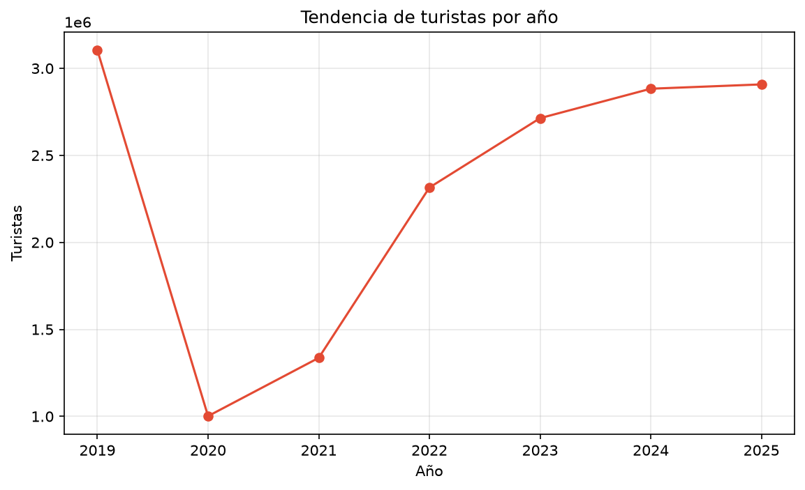
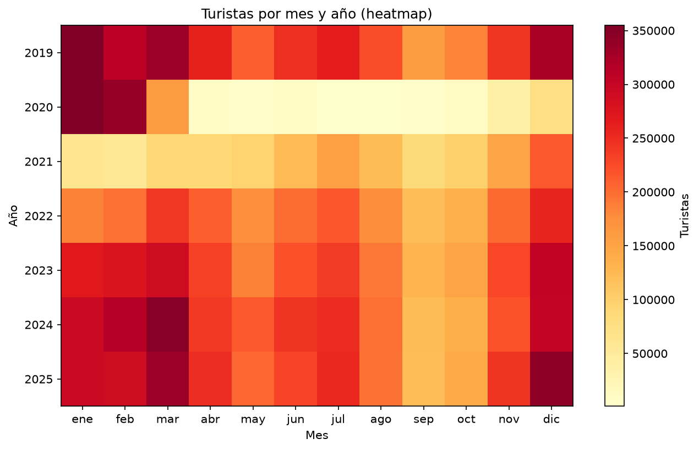
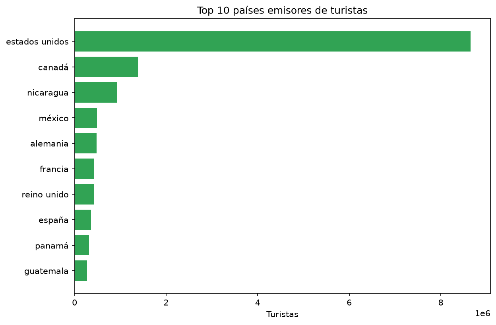

# Análisis y Predicción del Turismo en Costa Rica


Proyecto Final **BD-143 — Programación II** · Colegio Universitario de Cartago | II Cuatrimestre 2026 · Profesor: Osvaldo González Chaves

Pipeline completo de ciencia de datos: extracción automática de los PDF oficiales del ICT, enriquecimiento con datos climáticos de una API, carga en SQL Server, análisis exploratorio, comparación de modelos de regresión y dashboard interactivo con mapa mundial.

## 👥 Proyecto en equipo

- Jeremy Ramírez Pérez
- Gabriel Solano Molina
- Derek Barrantes Torres

Repositorio original del equipo: [GaboSM1507/Proyecto_Final_ProgramacionII](https://github.com/GaboSM1507/Proyecto_Final_ProgramacionII).

## ⚡ En resumen

- **Datos:** 14 informes semestrales del ICT (2019–2025) extraídos con `pdfplumber`, validados contra el Anuario Estadístico (coinciden exactamente), más temperatura mensual de Open-Meteo.
- **Modelo:** KNN elegido entre KNN, Regresión Lineal y Random Forest (R² = 0.65 en prueba).
- **Dashboard:** Streamlit con 5 pestañas y mapa coroplético de 67 países con Folium.

| Tendencia anual | Turistas por mes y año |
|---|---|
|  |  |



## Descripción

Proyecto de ciencia de datos en Python que analiza el comportamiento del turismo internacional en Costa Rica y predice la cantidad de turistas por país de origen y mes, considerando el clima como variable adicional. El proyecto integra datos oficiales del Instituto Costarricense de Turismo (ICT), datos climáticos históricos de la API de Open-Meteo, una base de datos relacional en SQL Server, un modelo de Machine Learning supervisado, y un dashboard interactivo.

## Fuentes de datos

**Turismo (ICT):** el ICT no publica un CSV/Excel descargable con el desglose por país y mes para varios años a la vez, solo lo reporta dentro de PDFs (Informes Semestrales y Anuarios). Se descargaron los **Informes Semestrales de Turismo** (2019-2025, I y II semestre cada uno) desde [ict.go.cr/es/estadisticas/informes-estadisticos.html](https://www.ict.go.cr/es/estadisticas/informes-estadisticos.html), y se escribió un script con la librería `pdfplumber` para extraer automáticamente el "Cuadro 1" (llegadas internacionales de turistas por país y mes) de cada PDF.

Los totales anuales extraídos por el script se validaron contra las cifras oficiales publicadas en el Anuario Estadístico de Turismo del ICT y coincidieron exactamente.

**Clima (Open-Meteo):** se consulta la API histórica de Open-Meteo (`archive-api.open-meteo.com`) para obtener la temperatura promedio diaria de Costa Rica, agregada después a nivel mensual.

## Estructura del proyecto

```
proyecto_final_programacionii/
├── src/
│   ├── datos/            → GestorDatos: extrae los PDFs del ICT y genera el CSV
│   ├── basedatos/         → GestorBaseDatos: conexión e integración con SQL Server
│   ├── api/               → ClienteAPI: conexión con Open-Meteo
│   ├── eda/               → ProcesadorEDA: análisis exploratorio de datos
│   ├── visualizacion/     → Visualizador y Mapas: gráficos y mapa mundial interactivo
│   ├── modelos/           → ModeloML: entrenamiento y comparación de modelos
│   ├── helpers/           → Utilidades: funciones auxiliares reutilizables
│   ├── dashboard/         → Dashboard interactivo con Streamlit
│   ├── reports/figures/   → Gráficos generados por el EDA
│   └── main.py            → Punto de entrada del proyecto
├── notebooks/
│   └── exploracion_inicial.ipynb  → Notebook de presentación de resultados
├── data/
│   ├── raw/informes_ict/  → PDFs originales del ICT
│   └── processed/         → turismo.csv (dataset limpio)
└── modelos_guardados/      → Modelo entrenado (.pkl, no se sube al repo por tamaño)
```

## Requisitos previos

- Python 3.13+
- SQL Server instalado localmente (o accesible en red), con una base de datos vacía llamada `TurismoCR` ya creada
- Driver ODBC de SQL Server instalado en el sistema operativo

## Instalación

```bash
python -m pip install -e .
```

O instalando las dependencias sueltas:

```bash
python -m pip install pandas pdfplumber requests pyodbc streamlit scikit-learn folium streamlit-folium plotly jupyter ipykernel
```

> **Nota:** si tu computadora tiene Anaconda instalado además de tu entorno virtual, usa siempre `python -m pip install` (no solo `pip install`) para evitar que las librerías se instalen en el entorno equivocado.

## Configuración de la base de datos

1. Abre SQL Server Management Studio (SSMS) y crea una base de datos vacía llamada `TurismoCR`.
2. En `src/basedatos/gestor_basedatos.py`, ajusta el nombre del servidor en el constructor de `GestorBaseDatos` al nombre de **tu propia máquina** (lo ves en SSMS al conectarte, campo "Nombre del servidor"). Puedes confirmarlo en la terminal con:
   ```
   hostname
   ```
   Cada integrante del equipo necesita ajustar esta línea con el nombre de su propia computadora antes de correr el proyecto localmente.

## Cómo correr el proyecto

**Pipeline completo** (extracción de datos → clima → base de datos → EDA → gráficos → modelo → predicción de ejemplo):

```bash
python src/main.py
```

La primera vez que corre, extrae los datos de los PDFs (`data/raw/informes_ict/`) y genera `data/processed/turismo.csv`. En corridas posteriores, reutiliza ese CSV si ya existe. El modelo entrenado se guarda en `modelos_guardados/modelo_ml_entrenado.pkl`; si ya existe, se carga directo en vez de reentrenar.

**Dashboard interactivo:**

```bash
streamlit run src/dashboard/dashboard.py
```

Abre en el navegador un dashboard con 5 pestañas: Panorama general, Clima, Países, Predicción, y Mapa mundial.

## Modelo de Machine Learning

Se comparan tres modelos de regresión (KNN, Regresión Lineal, Random Forest) usando como variables de entrada el país, el mes (codificado de forma cíclica) y la temperatura promedio, para predecir la cantidad de turistas. El mejor modelo (según MAE/RMSE/R²) se selecciona automáticamente y se guarda para su reutilización.

| Modelo | MAE | RMSE | R² |
|---|---|---|---|
| **KNN** (mejor modelo) | 1,105.56 | 6,008.99 | 0.6503 |
| Regresión Lineal | 1,123.72 | 6,261.30 | 0.6203 |
| Random Forest | 1,164.92 | 6,669.01 | 0.5693 |

> Las métricas se calculan sobre el conjunto de prueba, en número de turistas. La versión original del cálculo reportaba el MSE con el nombre de RMSE; se corrigió en `src/helpers/utilidades.py` (las salidas guardadas del notebook todavía muestran el valor anterior).

## Mapa interactivo

La pestaña "Mapa mundial" del dashboard muestra un mapa coroplético (con `Folium`, sobre tiles reales de OpenStreetMap/CartoDB) donde cada país aparece coloreado según su cantidad histórica de turistas hacia Costa Rica. De los 72 países/categorías del dataset, 67 se ubican en el mapa; 5 corresponden a categorías agregadas que el propio ICT reporta sin desglose por país individual (ej. "Otros Caribe", "Otros Europa") y por eso no tienen una ubicación geográfica única.

## Notebook de presentación

`notebooks/exploracion_inicial.ipynb` recorre los principales hallazgos del proyecto de forma narrativa: fuente de los datos, análisis exploratorio con los 6 gráficos y su interpretación, comparación de modelos de Machine Learning, el mapa mundial interactivo embebido, y las conclusiones finales. Reutiliza las mismas clases del proyecto (`ProcesadorEDA`, `Visualizador`, `Mapas`, `ModeloML`) en vez de duplicar código.

Para correrlo:

```bash
python -m pip install jupyter ipykernel
jupyter notebook notebooks/exploracion_inicial.ipynb
```

> Requiere haber corrido `python src/main.py` al menos una vez antes, para que existan `data/processed/turismo.csv` y `modelos_guardados/modelo_ml_entrenado.pkl`.

## Alcance y limitaciones

- El dataset cubre 2019-2025 (faltan algunos informes semestrales anteriores a 2019, no disponibles públicamente en el sitio del ICT).
- Los años 2020-2021 muestran una caída drástica en los datos por la pandemia de COVID-19; se mantuvieron en el dataset como parte real de la serie histórica.